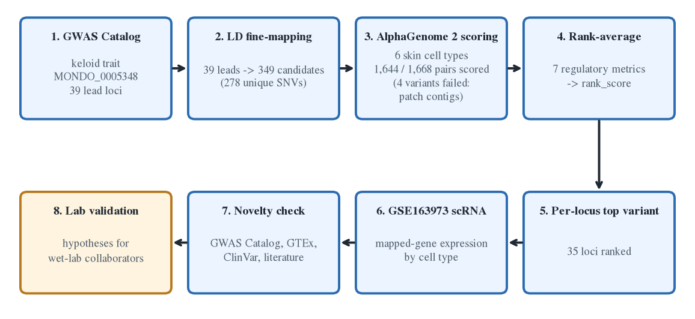
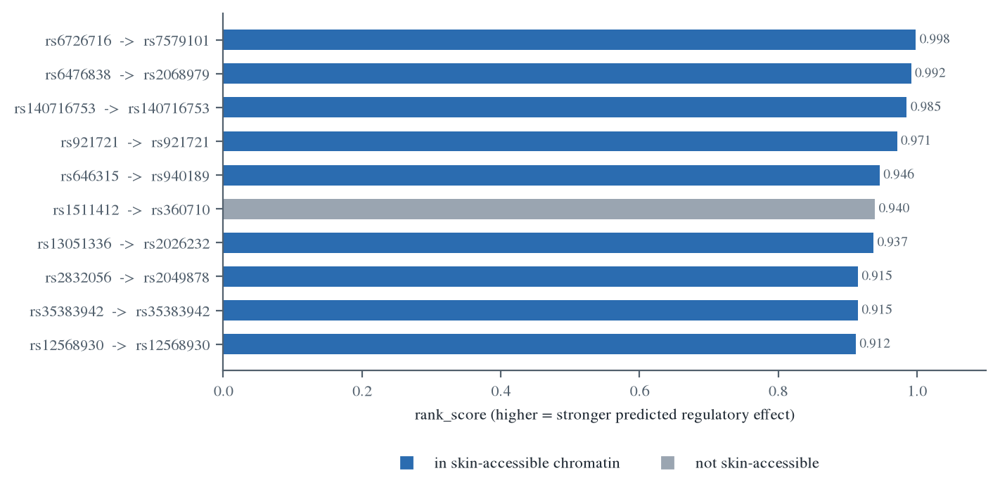
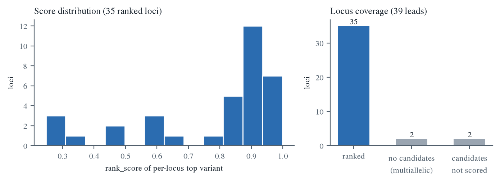
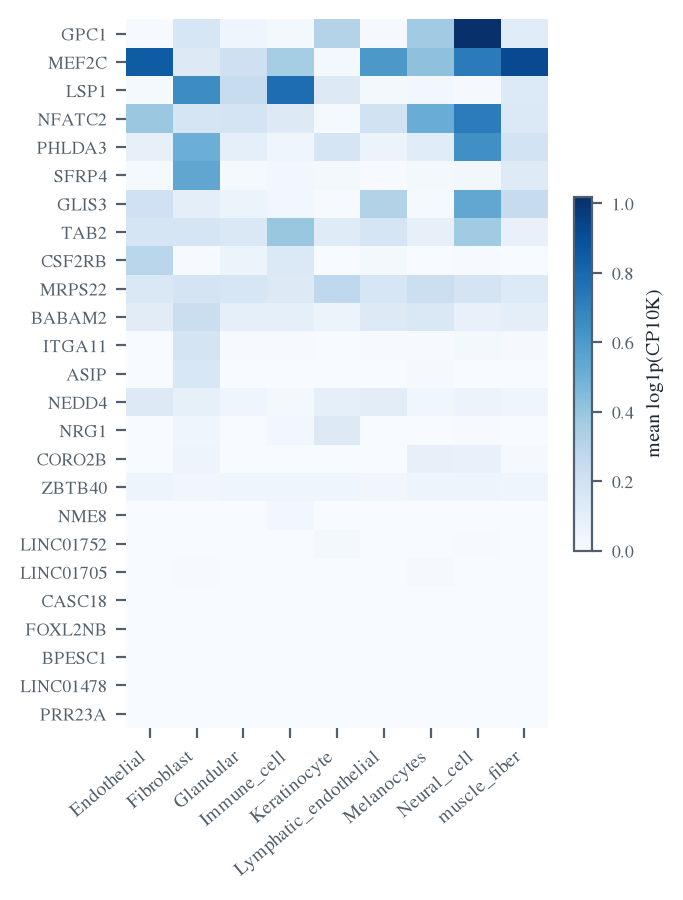
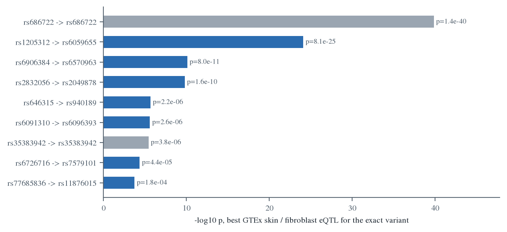

# Keloid Computational Genomics Pipeline

> **Research only. Hypothesis-generating. Not for clinical use.** All outputs are computational predictions, not experimental validation. **All 39 lead loci analysed are already published GWAS Catalog keloid hits; this repository does not report new loci.**

**Paper (preprint):** [`paper/keloid_finemapping_paper.pdf`](paper/keloid_finemapping_paper.pdf) · [Markdown](paper/keloid_finemapping_paper.md) · [references.bib](paper/references.bib)

## Overview

Keloids are fibroproliferative skin scars with a genetic component. Most GWAS hits are non-coding, so the causal variant and target gene are unclear. This pipeline fine-maps the published keloid GWAS loci by LD, scores every candidate variant for predicted regulatory effect in six skin-relevant cell types with AlphaGenome 2, checks which mapped genes are expressed in public keloid single-cell data, and checks each top variant against the GWAS Catalog, GTEx skin eQTLs and the literature. The contribution is **variant-level prioritisation and new mechanistic hypotheses at known loci**, intended for wet-lab collaborators.

**Key results** (numbers recomputed from `results/`; full detail in the paper):

- 39 lead variants (GWAS Catalog, trait `MONDO_0005348`, p < 5e-8, with rsID) → **349 LD candidate rows (278 unique SNVs)** at r² ≥ 0.8 in 1000 Genomes EUR/EAS. 686 proxy rows were excluded (586 multiallelic, 94 indels/non-SNV, 6 without a record).
- AlphaGenome 2 scored **1,644 of 1,668 variant × cell-type pairs**; 4 variants (rs4980389, rs569550, rs686722, rs76024540) failed (sequence window too short near patch contigs). 35 loci were ranked (2 leads had no candidates, 2 had candidates that could not be scored).
- The score is a rank-average of 7 predicted metrics; it is **uncalibrated and only weakly concordant** with prior GWAS evidence on a 50-variant benchmark (Spearman 0.12, 95% CI −0.20 to 0.44).
- GSE163973 (3 keloid + 3 normal-scar samples, 40,655 cells): *PHLDA3* is detected in 51% of fibroblasts, *BABAM2* in 30%; several mapped genes are essentially undetected.
- Three tier-2 variants have an exact-variant GTEx skin eQTL: rs2049878 (*N6AMT1*/*HEMK2*), rs940189 (*FOXL2*), rs7579101 (*BABAM2*).

**Novelty findings (variant-level tiers, all 39 leads).** Tier 1 = the variant itself is already a Catalog hit or named in published fine-mapping; tier 2 = known locus, but this variant and its predicted mechanism are not named in the sources we found ("not named", **not** proven novel); tier 3 = unreported.

| Tier | Leads | Top 10 loci |
|---|---|---|
| 1 (already known) | 15 | 4 (rs140716753, rs921721, rs35383942, rs12568930) |
| 2 (known locus, variant/mechanism not named) | 24 | 6 (rs7579101, rs2068979, rs940189, rs360710, rs2026232, rs2049878) |
| 3 (unreported) | 0 | 0 |

Applying the literal rule (a proxy at r² ≥ 0.8 of a significant hit is "already known") makes all 39 leads tier 1, because every candidate was selected at r² ≥ 0.8 with its lead. That is circular, so the strict variant-level tier is the main result. Only the top 10 loci got a literature search; the other 29 tiers (Catalog + GTEx only) are provisional. Greene *et al.* 2025 already fine-mapped rs140716753 and rs35383942 (and rs76024540).

### Top 10 loci

| # | Lead → variant | Gene (Catalog) | rank_score | Skin chromatin flag | GTEx skin eQTL | Tier |
|---|---|---|---|---|---|---|
| 1 | rs6726716 → rs7579101 | BABAM2 | 0.998 | yes | y (p = 4.4e-5) | 2 |
| 2 | rs6476838 → rs2068979 | GLIS3 | 0.992 | yes | n | 2 |
| 3 | rs140716753 → rs140716753 | LINC02871; RPS11P1 | 0.985 | yes | n | 1 |
| 4 | rs921721 → rs921721 | TRIB1AL | 0.971 | yes | n | 1 |
| 5 | rs646315 → rs940189 | BPESC1; MRPS22 | 0.946 | yes | y (p = 2.15e-6) | 2 |
| 6 | rs1511412 → rs360710 | FOXL2NB; PRR23A | 0.940 | **no** | n | 2 |
| 7 | rs13051336 → rs2026232 | LINC03138 | 0.937 | yes | n | 2 |
| 8 | rs2832056 → rs2049878 | LINC03138 | 0.915 | yes | y (p = 1.6e-10) | 2 |
| 9 | rs35383942 → rs35383942 | PHLDA3 | 0.915 | yes | y (p = 3.8e-6) | 1 |
| 10 | rs12568930 → rs12568930 | PPIAP34; ZBTB40 | 0.912 | yes | n | 1 |

rs360710 has no predicted skin accessibility, so its high rank lacks skin chromatin support. The full 39-lead table is Supplementary Table S1 in the paper and `results/novelty/novelty_all_loci.csv`.

## What this is / is not

| This is | This is not |
|---|---|
| A reproducible in-silico prioritisation of keloid GWAS variants at known loci | A discovery of new loci, or validation of causal variants |
| Predictions from AlphaGenome 2 plus public expression and eQTL data | Clinical, diagnostic or treatment advice |
| A starting list for wet-lab collaborators | A claim that any variant or gene is a drug target |
| Mostly about non-coding regulation | A protein-structure study (AlphaFold 3 work is a short, exploratory side section) |

## Pipeline



1. **GWAS Catalog** keloid trait `MONDO_0005348`: 39 lead loci.
2. **LD fine-mapping**: 39 leads expand to 349 candidates (278 unique SNVs).
3. **AlphaGenome 2 scoring** in 6 skin cell types: 1,644 of 1,668 variant-cell pairs scored.
4. **Rank-average** of 7 regulatory metrics gives `rank_score`; accessibility flag at the 90th percentile.
5. **Per-locus top variant**: 35 loci ranked.
6. **GSE163973** scRNA-seq: expression of mapped genes by cell type.
7. **Novelty check** against GWAS Catalog, GTEx skin eQTL, ClinVar and literature.
8. **Lab validation** (outside this repo).

### Figures

| | |
|---|---|
|  |  |
|  |  |

SVG versions are in `figures/`.

## Hypotheses for lab validation

**These are hypotheses, not findings.** Strongest first. Suggested assays: reporter (luciferase or massively parallel) assays with reference vs alternative allele; CRISPR editing or CRISPRi/dCas9-KRAB in keloid and normal fibroblasts; allelic expression imbalance and eQTL testing in heterozygous donor fibroblasts. Include the lead SNP, low-ranked proxies as negative controls and a locus with strong independent evidence (e.g. *PHLDA3* rs35383942) as positive control.

| Priority | Variant → gene | Support so far | Caveats |
|---|---|---|---|
| 1 | rs2049878 → *N6AMT1*/*HEMK2* | GTEx v10 skin eQTL (sun-exposed p = 1.6e-10; cultured fibroblasts p = 2.1e-9); predicted skin-accessible | Lead rs2832056 shares the eQTL, so proxy vs lead is unresolved; ~197 kb from the *HEMK2* TSS; no keloid literature on *HEMK2* found |
| 2 | rs940189 → *FOXL2* | GTEx v10 skin eQTL (not-sun-exposed p = 2.15e-6); r² = 0.994 (EUR) with the 3q22.3 lead rs940187 | Whether it converges with the rs1511412 *FOXL2* block (r² ≈ 0.42) is untested; no EUR r² to its own Catalog lead |
| 3 | rs7579101 → *BABAM2* | Highest predicted effect of any locus; *BABAM2* detected in 43% of keloid fibroblasts | eQTL weak and only in GTEx v10 not-sun-exposed skin (p = 4.4e-5) |

## Repository tree

```text
.
├── README.md  LICENSE  LICENSE-DATA  TERMS_NOTICE.md  CONTRIBUTING.md  CITATION.cff
├── requirements.txt
├── paper/                   # preprint: .md, .pdf, references.bib, paper_source.md (template)
├── figures/                 # fig1-fig5 (PNG 200 dpi + SVG)
├── scripts/                 # fetch, fine-map, score, rank, report, figures, paper build
│   ├── fetch_keloid_data.py  build_finemap_candidates.py  run_alphagenome.py
│   ├── rank_finemap.py  gse163973_gene_by_celltype.py  benchmark_vs_prior.py
│   ├── prepare_alphafold_jobs.py  compare_structures*.py  generate_report.py
│   ├── fetch_raw_data.py    # downloads GSE163973 (not stored in repo)
│   └── make_figures.py  build_paper.py
├── data/
│   ├── raw/keloid_gwas_variants.csv      # small public input
│   └── processed/                        # candidates, exclusions, sequences, AF Server job inputs
├── results/
│   ├── alphagenome/                      # scores, rankings, per-locus top variants, expression table
│   ├── novelty/                          # tier table (39 leads), top-10 notes, verified references
│   └── alphafold/                        # derived summary tables only (no structure files)
└── reports/                              # markdown reports and notes
```

## How to reproduce (Windows PowerShell)

Requires Python 3.11 and an AlphaGenome API key (free, non-commercial). Call the venv Python directly; do not rely on `.bat` activation (an `&` in a folder path can break it).

```powershell
# 1. Environment
python -m venv venv
venv\Scripts\python.exe -m pip install -r requirements.txt

# 2. API key (never commit this file)
"ALPHAGENOME_API_KEY=your_key_here" | Out-File -Encoding ascii .env

# 3. Ingest and fine-map
venv\Scripts\python.exe scripts\fetch_keloid_data.py
venv\Scripts\python.exe scripts\build_finemap_candidates.py

# 4. Score with AlphaGenome 2, then rank
venv\Scripts\python.exe scripts\run_alphagenome.py
venv\Scripts\python.exe scripts\rank_finemap.py

# 5. Single-cell expression (raw data ~2.9 GB; list first)
venv\Scripts\python.exe scripts\fetch_raw_data.py --dry-run
venv\Scripts\python.exe scripts\fetch_raw_data.py
venv\Scripts\python.exe scripts\gse163973_gene_by_celltype.py

# 6. Figures, report, paper
venv\Scripts\python.exe scripts\make_figures.py
venv\Scripts\python.exe scripts\generate_report.py
venv\Scripts\python.exe scripts\build_paper.py --pdf   # needs pandoc + tectonic on PATH (LaTeX, two-column preprint layout)
```

**What has been tested** (2026-11-17, on a copy of this folder): `rank_finemap.py` regenerates `finemap_ranking_all.csv` and `finemap_top_per_locus.csv` byte-identically from the shipped scores and candidates; `fetch_raw_data.py --dry-run` lists the GSE163973 files (2.87 GB total); `make_figures.py` and `build_paper.py --pdf` run on the shipped data (the latter needs `pip install markdown` and Chrome or Edge). **Not re-run for this release:** `fetch_keloid_data.py`, `build_finemap_candidates.py` (live APIs), `run_alphagenome.py` (needs your key; the AlphaGenome v2 imports were patched and verified, runtime of some skill scripts is untested), `gse163973_gene_by_celltype.py` and `benchmark_vs_prior.py` (need the raw download / API access), `generate_report.py`. Script arguments and order may differ slightly; check each script's header. The optional AlphaFold 3 part is manual: `prepare_alphafold_jobs.py` writes inputs for AlphaFold Server; structure files are not redistributed.

## Data sources, licences and terms

| Source | Use | Terms |
|---|---|---|
| GWAS Catalog (REST v2) | keloid loci | EMBL-EBI terms; cite the catalog (Sollis 2023) |
| Ensembl (GRCh38, REST/VEP/LD) | sequence, LD, consequences | Ensembl terms; cite (Dyer 2025) |
| UniProt | protein sequences | CC BY 4.0 |
| GTEx (v8 and v10 portal) | skin eQTL context | GTEx data-use terms; cite (GTEx Consortium 2020) |
| GEO GSE163973 | keloid scRNA-seq (not redistributed) | GEO terms; cite Deng *et al.* 2021 |
| AlphaGenome 2 (Avsec 2026) | variant scoring | Google non-commercial terms; outputs shared with notice, see below |
| AlphaFold 3 via AlphaFold Server (Abramson 2024) | exploratory structures | AlphaFold Server terms: non-commercial, no docking/ligand-binding use, no model training |

**Licence summary.** Code is MIT. Author-written text and data without AlphaGenome/AlphaFold content are CC BY 4.0. **AlphaGenome- and AlphaFold-derived tables, figures and reports are *not* CC BY**: Google's Output Terms allow public, non-commercial sharing with a conspicuous notice and require their use restrictions to travel with each copy. See [`TERMS_NOTICE.md`](TERMS_NOTICE.md) and [`LICENSE-DATA`](LICENSE-DATA). In short: non-commercial research only; no training of variant-effect or structure-prediction models; no docking; no clinical use.

## Limitations

- Predictions, not validation. No experiment has confirmed any variant. The score is uncalibrated and was developed without held-out data.
- No new loci: all 39 leads are published Catalog hits; tier 2 means "not named in sources we found". Only 10 of 39 tiers are literature-checked; the rest are provisional.
- LD fine-mapping uses 1000 Genomes EUR/EAS r² and cannot replace statistical fine-mapping; no African-ancestry panel, although two top African-ancestry variants (rs140716753, rs76024540) are poorly served.
- 686 proxy rows (indels, multiallelic) were not scored; 4 variants failed (patch contigs); 4 tier-1 leads are unranked.
- Most keloid GWAS hits are non-coding; the structural part covers three coding variants, found no change beyond seed noise, and AlphaFold 3 cannot assess point-mutation stability or binding.
- For rs35383942, the AlphaGenome-predicted direction conflicts with GTEx/TWAS evidence (unresolved).
- scRNA expression comes from one public dataset (3 vs 3 samples); several genes of interest (*FOXL2*, *HEMK2*, *JAG1*, *TRIB1*) were not summarised.
- Boltz-2 or AlphaFold 2 results, if any, are never labelled AlphaFold 3.

## Deferred / future work

- **Structure work:** expand the AlphaFold 3 section (e.g. PHLDA3 missense rs35383942, with ancestry-matched context) if the collaborators want it.
- **Tighter novelty bar:** re-run the check with "no keloid or fibrosis mention at all" for the variant and gene, after the lists are final; read the Greene 2025 supplementary tables; literature-check the 29 light-pass loci.
- **Rescore the 4 failed variants** (rs4980389, rs569550, rs686722, rs76024540) with a sequence window that handles patch contigs (or lift to primary-assembly coordinates).
- Statistical fine-mapping with summary statistics, an African-ancestry LD panel, and indel/multiallelic handling.

## Contributing

See [CONTRIBUTING.md](CONTRIBUTING.md).

## Citation

See [CITATION.cff](CITATION.cff). Version 0.1.0; DOI to be added (Zenodo). Preprint: Abdel Nasser MG. *Variant-level prioritisation of keloid GWAS loci with LD fine-mapping and AlphaGenome 2: predicted skin regulatory effects and testable hypotheses.* Preprint v0.1.0, 2026 (`paper/keloid_finemapping_paper.pdf`).

## Contact

Mirza Gamal Abdel Nasser, mirzagamalabdelnasser@gmail.com. Please open a GitHub issue for questions or wet-lab collaboration; pull requests welcome.

*Analysis assisted by Claude (Anthropic).*
