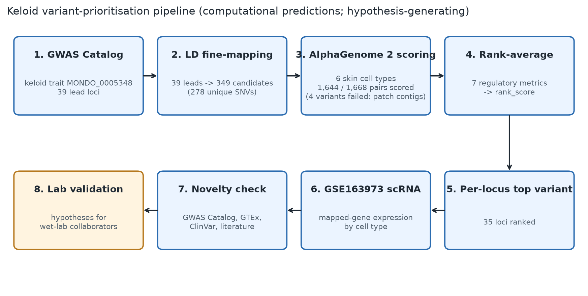
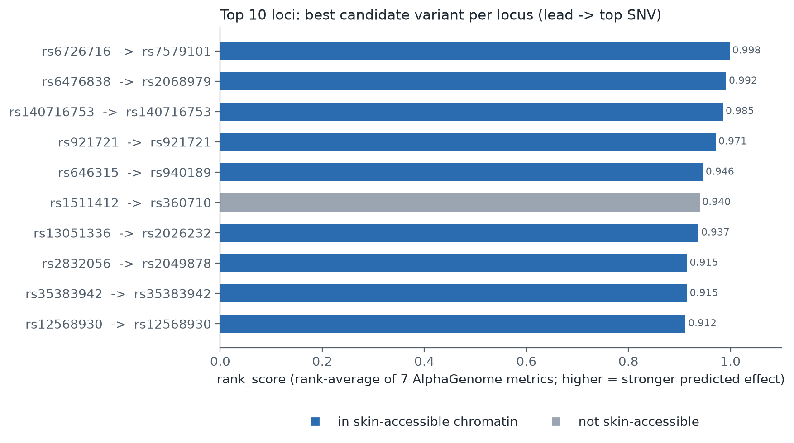
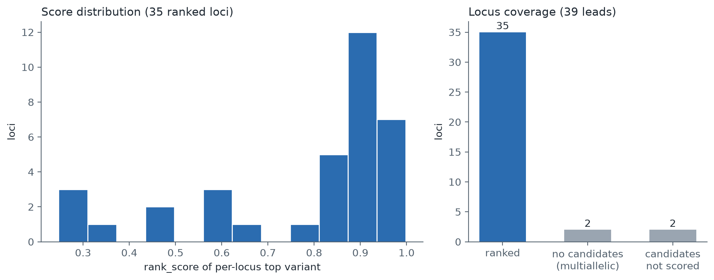
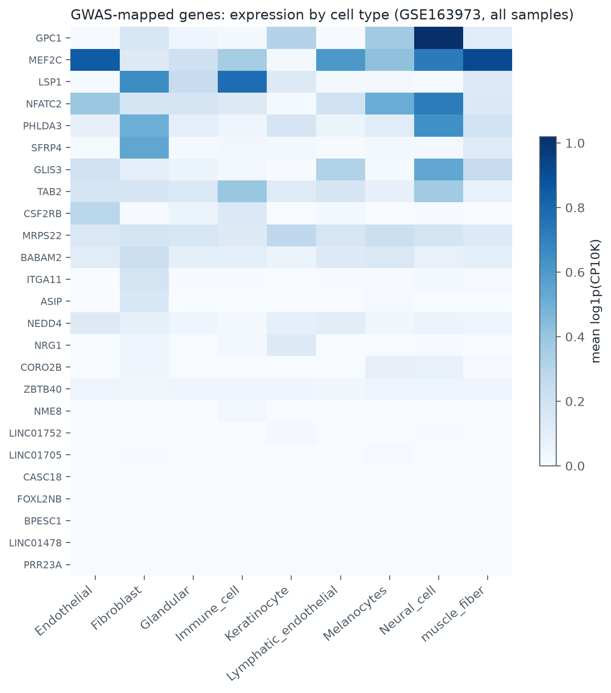
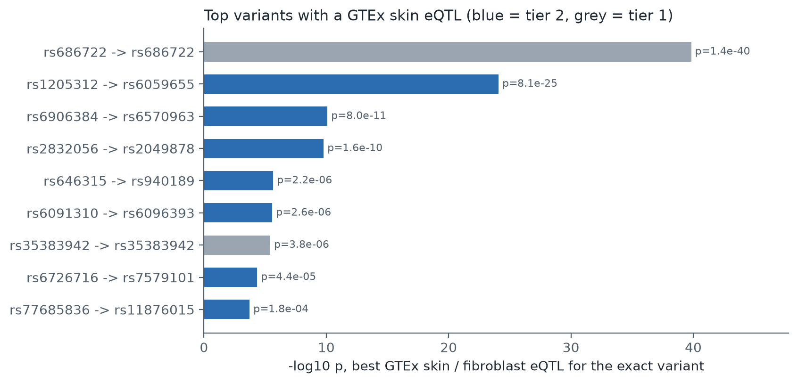

# Variant-level prioritisation of keloid GWAS loci with LD fine-mapping and AlphaGenome 2: predicted skin regulatory effects and testable hypotheses

**Mirza Gamal Abdel Nasser** (mirzagamalabdelnasser@gmail.com)

*Analysis assisted by Claude (Anthropic).* Preprint, version 0.1.0, 17 November 2026. Research use only; not clinical advice.

> **Status.** Hypothesis-generating computational study. Nothing here is experimentally validated. All 39 lead loci analysed are already published genome-wide-significant keloid associations in the GWAS Catalog; this work does **not** report new loci.

## Abstract

**Background.** Keloids are fibroproliferative skin scars with a genetic component supported by GWAS. Genome-wide association studies (GWAS) have reported dozens of loci, but most lead variants are non-coding and the causal variant and target gene are rarely known.

**Methods.** We took 39 lead variants with genome-wide-significant keloid associations in the GWAS Catalog (trait MONDO_0005348), expanded each to linkage-disequilibrium (LD) proxies (r² ≥ 0.8 in 1000 Genomes EUR or EAS) giving 349 candidate rows (278 unique single-nucleotide variants; 686 indels, multiallelic and unannotated proxies were excluded), and scored candidates with AlphaGenome 2 in six skin-relevant cell types (1,644 of 1,668 variant-cell-type pairs scored; 4 variants could not be scored). Seven predicted regulatory metrics were rank-averaged into one untuned score and the top variant was taken per locus (35 loci ranked). We described expression of mapped genes in a public keloid single-cell dataset (GSE163973; 40,655 cells) and checked each locus against the GWAS Catalog, GTEx skin eQTLs, ClinVar and the literature, assigning a variant-level novelty tier.

**Results.** Of 39 leads, 15 were tier 1 (the variant itself is already a Catalog hit or named in published fine-mapping) and 24 were tier 2 (known locus; the top proxy variant and its predicted mechanism are not named in the sources we found); none was tier 3. Among the top 10 loci, 4 were tier 1 and 6 tier 2. Three tier-2 top variants are exact-variant GTEx skin eQTLs: rs2049878 (*N6AMT1*/*HEMK2*, p = 1.6e-10), rs940189 (*FOXL2*, p = 2.15e-6) and rs7579101 (*BABAM2*, p = 4.4e-5). Concordance of the AlphaGenome score with prior GWAS evidence on a 50-variant benchmark was weak (Spearman 0.12, 95% CI −0.20 to 0.44), so the ranking is uncalibrated.

**Conclusions.** The contribution is variant-level prioritisation and mechanistic hypotheses (skin eQTL, predicted skin chromatin effect) at known loci. We propose reporter, CRISPR-editing/CRISPRi and allelic-expression experiments, strongest hypotheses first, for wet-lab collaborators.

## 1. Introduction

Keloids are raised scars that grow beyond the original wound. GWAS in Japanese, Chinese Han, European and multi-ancestry cohorts have reported a growing set of susceptibility loci [1–3, 14–17]. The first Japanese GWAS reported four loci [2], including a 3q22.3 signal near *FOXL2* whose lead rs1511412 was replicated in Chinese Han populations [3–5], and a recent multi-ancestry meta-analysis reported further loci and putatively causal variants by statistical fine-mapping [1].

Two problems limit what a bench scientist can do with these results. First, GWAS lead variants are tags. A lead is usually one of many variants in strong LD, and the causal variant (and the gene it acts on) is typically unknown. Second, most hits are non-coding, so their effect is presumably regulatory and cell-type specific. Functional follow-up exists for a few loci, for example a risk SNP that alters an enhancer–promoter interaction and a long non-coding RNA [6], and *JAG1*/Notch signalling has been studied in keloid fibroblasts independently of any one GWAS variant [8–10], but for most loci no variant-level mechanism has been proposed.

Sequence-to-function models can score non-coding variants. AlphaGenome [18] predicts chromatin accessibility, histone and transcription-factor binding, transcription initiation and gene expression across many cell types from DNA sequence, and can compare reference and alternative alleles. AlphaFold 3 [19] predicts biomolecular structures, which is relevant only to the few coding keloid variants.

Here we ask a narrow question: among LD proxies of published keloid lead variants, which single variants does AlphaGenome predict to have the strongest regulatory effect in skin cell types, and for which of these is there independent support or an obvious experiment? We then check, for the top loci, what is already known. We make no claim that any locus is new. The aim is a short, honest list of variant-level hypotheses that a wet-lab group can test.

## 2. Methods

Figure 1 shows the pipeline. All scripts, derived tables and figures are in the accompanying repository (Section 8).

### 2.1 Lead variants

Keloid associations were retrieved from the GWAS Catalog REST API v2 [21] (trait MONDO_0005348; the associations we used come from [1, 2, 14–17]). We kept the 39 distinct variants with an rsID and a reported p < 5 × 10⁻⁸. Two additional Catalog associations without an rsID (chr15:56140995 and chr15:68789191, both from [17]) were not carried forward. Every one of the 39 leads is therefore, by construction, a published genome-wide-significant keloid hit.

### 2.2 LD fine-mapping

For each lead we retrieved LD proxies with r² ≥ 0.8 from Ensembl REST [23] using 1000 Genomes phase 3 EUR and EAS panels (GRCh38), and annotated them with the Ensembl Variant Effect Predictor. Proxies were kept if they were biallelic single-nucleotide variants. This gave **349 candidate rows** (lead–proxy pairs, including the lead itself when eligible), corresponding to **278 unique SNVs**, for 37 of the 39 leads. **686 proxy rows were excluded**: 586 multiallelic, 94 indels or other non-SNVs, and 6 with no Ensembl/VEP record. Two leads (rs527569697, rs549023067) had no eligible candidate. This is LD-based candidate selection, not statistical fine-mapping: it does not use association summary statistics and cannot assign posterior probabilities. We did not use an African-ancestry panel.

### 2.3 AlphaGenome scoring

Each candidate was scored with the AlphaGenome 2 API [18] (cloud model, v2; free non-commercial access under the AlphaGenome terms) as reference versus alternative allele in six skin-related conditions: skin fibroblast (UBERON:0002097_CL:0002620), dermal fibroblast, myofibroblast, skin keratinocyte (UBERON:0002097_CL:0000312), macrophage and endothelial cell. Condition identifiers were chosen explicitly, not by first search match. For each variant–condition pair we recorded, as the maximum absolute effect over the window, seven predicted metrics: ATAC, DNase, CAGE, ChIP-histone, ChIP-TF, single-cell ATAC and RNA-seq (log fold change). **1,644 of 1,668 variant–condition pairs (274 of 278 variants × 6 conditions) were scored.** Four variants (rs4980389, rs569550, rs686722, rs76024540) could not be scored because the required sequence window was too short near patch contigs; all candidate rows of leads rs686722 (3 rows) and rs76024540 (1 row) are these variants, so those two leads are unranked.

### 2.4 Ranking

For each metric we took the maximum over the six conditions (RNA as |log fold change|), converted it to a percentile rank across all 274 scored variants, and averaged the seven ranks into `rank_score` (0–1; higher = stronger predicted effect). The recipe was fixed before looking at results and was not tuned. The top variant per locus is the candidate with the highest `rank_score` for that lead; 35 loci were ranked, 2 leads had no candidates, and 2 had candidates that could not be scored. A **skin-accessibility flag** marks variants whose ATAC, DNase or ChIP-histone effect in skin fibroblast or keratinocyte is at or above the 90th percentile of that metric over all variant–condition rows. This flag is a within-dataset percentile, not a calibrated probability.

### 2.5 Benchmark against prior evidence

There is no gold-standard causal-variant set for keloid. We therefore measured *concordance* of the same scoring recipe (percentile ranks computed within the 50-variant set) with independent prior evidence on 50 variants (44 in the Catalog keloid set; 6 literature seed variants), using genome-wide significance, replication in at least two publications, exact-variant GTEx skin/fibroblast eQTL status and literature co-mention as labels, with Spearman correlation and area under the ROC curve (AUC) with bootstrap 95% confidence intervals, and a family-wise permutation test across 23 scoring recipes. Older free predictors (phyloP, phastCons, ENCODE cCRE overlap) were run as comparators.

### 2.6 Single-cell expression

We summarised expression of mapped genes in GEO series GSE163973 [20]: scRNA-seq of dermis from 3 keloid and 3 normal-scar samples (21,488 and 19,167 cells; 40,655 cells in total), using the authors' published cell-type labels. For 30 genes (GWAS-mapped genes and marker controls) we computed per-cell-type mean log1p(CP10K) and the percentage of cells with detected expression, overall and by condition. These are descriptive cell-level summaries, not donor-level differential-expression tests.

### 2.7 Novelty check and tiers

For each of the 39 leads we examined the top candidate variant. The ten top-ranked loci received a *deep* check: the GWAS Catalog (variant-level associations), GTEx [22] exact-variant eQTLs in sun-exposed and not-sun-exposed skin and cultured fibroblasts (v8 and v10), ClinVar, dbSNP, Ensembl LD, PubMed and Europe PMC open-access full-text search for the rsID and gene with keloid, scar and fibrosis, and Open Targets. The other 29 leads received a *light* check (GWAS Catalog and GTEx only, no literature search), so their tiers are provisional. Date of check: 17 November 2026.

The **variant-level tier rule** is:

- **Tier 1:** the variant itself is a genome-wide-significant keloid hit in the GWAS Catalog, or a published fine-mapping or functional paper names it.
- **Tier 2:** the locus is a published keloid hit, but this specific variant (an LD proxy of the lead) and its predicted mechanism are not named in the sources we found.
- **Tier 3:** variant and gene both unreported and with no skin eQTL.

The tier-2 wording means "not named in the sources we found", not "proven novel". Applying the originally specified rule *literally*, that an LD proxy at r² ≥ 0.8 of a genome-wide-significant hit counts as already known, would make all 39 leads tier 1, because every candidate was selected at r² ≥ 0.8 with its lead; the rule is then circular and uninformative. We therefore report the strict variant-level tier as the main result and the literal-rule result in the supplementary table.

### 2.8 Exploratory structure work

For the three coding variants in the set (PHLDA3 p.Arg28Gln rs35383942, PHLDA3 p.Glu62Gly rs192314256, MYO7A p.Val679Ile rs35641839), we submitted wild-type and variant sequences to AlphaFold Server (AlphaFold 3 [19]), five models per job, and compared C-alpha RMSD and pLDDT with the wild-type-to-wild-type seed variation as noise floor. This part is exploratory and is not part of the ranking.

## 3. Results

### 3.1 Fine-mapping and ranking

The 39 leads expanded to 349 candidate rows (278 unique SNVs), of which 290 were intronic and 30 intergenic; three were missense. After exclusions and scoring failures, 345 lead–variant rows (274 variants) were ranked. The per-locus top variant was a proxy rather than the lead itself in 24 of 35 loci, and the lead itself in 11. The 35 top-variant scores are concentrated at the high end (Figure 2b), as expected from taking a per-locus maximum. Of all 345 ranked rows, 88 were flagged skin-accessible, and 21 of the 35 per-locus top variants were.

### 3.2 Top ten loci

Table 1 lists the ten top-ranked loci. `rank_score` values are relative (a percentile-based average), `max |effect|` is the largest single-track predicted log fold change and is not comparable across assay types. Ties are possible: rs2049878 and rs35383942 have the same `rank_score` to six decimals (0.915016).

{{T1}}

Notes on the table. (i) rs940189 has no EUR r² to its lead rs646315 in the 1000 Genomes EUR panel (it was selected by EAS LD); it is r² = 0.994 (EUR) with rs940187, the 3q22.3 lead of the earlier Japanese GWAS [2]. (ii) **rs1511412 → rs360710 is not skin-accessible** in this model despite a high rank, so its regulatory prediction lacks skin chromatin support and should be down-weighted. (iii) Four of the ten are tier 1; the coding variant rs35383942 and rs12568930 have the weakest predicted single-track effects (max |effect| 0.32).

### 3.3 Concordance with prior evidence: the score is weakly informative

On the 50-variant benchmark the rank-average score showed weak, statistically unconvincing concordance with prior GWAS evidence: Spearman correlation with −log10 p was 0.12 (95% CI −0.20 to 0.44, p = 0.42); AUC for variants replicated in at least two publications was 0.65 (0.39 to 0.89, p = 0.17), with 4 of its top 10 being replicated leads against 1.8 expected (hypergeometric p = 0.065). Across 23 recipe variants Spearman ranged from 0.01 to 0.21, with every interval including 0, and the replicated-label AUC ranged from 0.57 to 0.88 depending on recipe, so the headline depends on a choice the sample cannot make. The AUC for genome-wide significance (0.80, 0.53 to 1.00) is not evidence of success because only 3 of 44 Catalog variants were non-significant. The one recipe with a signal was the AlphaGenome Atlas variant-impact (AVI) score (AUC 0.88, 0.70 to 1.00 for replicated leads; family-wise permutation p ≈ 0.001), but it was tested after seeing the other recipes, is not independent of conservation (7 of its top 10 are shared with phyloP), and is not the score used for the ranking here. Free older predictors performed about as well on the same label (ENCODE cCRE overlap AUC 0.71, phastCons 0.77). **We therefore treat `rank_score` as an uncalibrated prioritisation heuristic, not a validated predictor of causal variants.**

### 3.4 Expression of mapped genes by cell type

In GSE163973 (Figure 3), *PHLDA3* was detected in 51.1% of fibroblasts overall (62.8% in keloid, 42.4% in normal-scar fibroblasts) and in 50.4% of cells labelled neural; *BABAM2* in 29.9% of fibroblasts (43.1% keloid, 20.1% normal scar); *GLIS3* in 14.1% of fibroblasts but 30.3% of lymphatic endothelial and 42.1% of neural cells; *MRPS22* was highest in keratinocytes (44.9%); *BPESC1*, *FOXL2NB* and *PRR23A* were essentially undetected (≤ 0.1%) in all cell types. *FOXL2*, *HEMK2*/*N6AMT1*, *JAG1* and *TRIB1* were not among the 30 genes summarised, so no expression statement is made for them. Keloid-versus-scar differences are cell-level percentages from 3 versus 3 samples, without donor-level modelling, and are descriptive only. Cell-type labels are those of the dataset (for example "muscle_fiber").

### 3.5 Novelty tiers

Of the 39 leads, **15 were tier 1, 24 tier 2 and 0 tier 3**; under the literal LD rule all 39 would be tier 1 (Table S1). The ten deep-checked loci comprised 4 tier 1 (rs140716753, rs921721, rs35383942, rs12568930) and 6 tier 2 (rs7579101, rs2068979, rs940189, rs360710, rs2026232, rs2049878). The 29 light-pass tiers are provisional (11 tier 1, 18 tier 2). Four tier-1 leads (rs527569697, rs549023067, rs686722, rs76024540) were not scored by AlphaGenome.

No locus is unreported: every lead is a published Catalog keloid hit, so tier 3 is empty by construction, and tier-2 status reflects that we found no source naming the variant, not that none exists. The deep-check evidence per variant is in `results/novelty/novelty_top10_notes.md`. Key points:

- **Already known (tier 1).** rs35383942 (*PHLDA3*) and rs140716753 are already named as putatively causal in the multi-ancestry fine-mapping of Greene *et al.* [1] (the latter in African-ancestry analysis, labelled *JAG1* although it lies about 451 kb from the *JAG1* transcription start site, which we regard as a mapping label rather than demonstrated regulation); rs76024540 is named there as well. rs921721 and rs12568930 are Catalog lead hits without fine-mapping or functional papers that we found.
- **Tier-2 variants with a GTEx skin eQTL (Figure 4).** rs2049878 is an eQTL for *N6AMT1* (*HEMK2*) in sun-exposed skin (p = 1.6e-10) and cultured fibroblasts (p = 2.1e-9); its lead rs2832056 is also an eQTL for the same gene (sun-exposed p = 4.7e-10; fibroblasts p = 1.4e-11), so the two cannot be separated without further work. rs940189 is a *FOXL2* eQTL (v10 sun-exposed p = 8.0e-6, not-sun-exposed p = 2.15e-6) and tags rs940187 [2, 4] at r² = 0.994 (EUR). rs7579101 is a *BABAM2* eQTL only in v10 not-sun-exposed skin (p = 4.4e-5; not significant in v8 or sun-exposed skin), and has the largest predicted single-track effect of any locus top variant (max |effect| 4.7).
- **Context without a link to the variants.** No keloid, scar or fibrosis paper on *BABAM2*, *HEMK2*/*N6AMT1*, *TRIB1*, *BPESC1*/*MRPS22* or *LINC03138* was found in PubMed. *GLIS3* has fibrosis literature outside skin (intestinal fibroblasts [7]); *WNT4* (the nearest well-studied gene to rs12568930, TSS 232 kb away) has skin-fibrosis literature [11, 12]; no source links the variant to these genes. Open Targets lists *HEMK2* and *GLIS3* among keloid-associated targets (ranks 3 and 22 of the 25 returned; evidence type not examined).
- **Gene labels disagree between sources.** rs921721 is *TRIB1AL* (Ensembl) or *LINC02964* (dbSNP); rs2049878 is *LINC03138* in the Catalog/VEP mapping and *N6AMT1* in dbSNP.

Across all 39 top variants, 9 have an exact-variant GTEx skin/fibroblast eQTL, 25 do not and 5 were not in GTEx; for the 29 light-pass leads this is an exact-variant check only.

### 3.6 Exploratory structure section (AlphaFold 3 via AlphaFold Server)

*This section is exploratory and secondary.* It covers the three coding variants only; the keloid hits are overwhelmingly non-coding. For PHLDA3 R28Q (rs35383942) the mean C-alpha RMSD of variant versus wild-type models was 0.68 Å (range 0.44–0.83) against a wild-type-to-wild-type noise of 0.82 Å (0.51–1.21); the local (residues 23–33) values were 0.34 Å versus 0.42 Å. For E62G (rs192314256) they were 0.60 Å versus 0.82 Å, local 0.30 Å versus 0.88 Å. For MYO7A V679I (rs35641839; a 2,215-residue single chain without partners) the motor-domain refit RMSD was 0.36 Å versus a noise of 0.49 Å, and pLDDT near residue 679 was unchanged (90.8 versus 91.3). **In all three comparisons the variant differed from wild type by less than the seed-to-seed noise, so no structural change is detected.** This is expected, since AlphaFold 3 does not predict the stability or binding effect of point substitutions, and a null result does not show the variants are harmless. Each comparison uses five models from one run.

Two context points matter more than the structures. *PHLDA3* R28Q is common (allele frequency 5.4% overall in gnomAD v4, SIFT deleterious but PolyPhen benign), so the Greene signal is more plausibly regulatory [1]; the T allele is a GTEx skin eQTL raising *PHLDA3* expression (NES +0.28 sun-exposed, +0.26 not-sun-exposed), and the same study reports higher predicted *PHLDA3* expression in not-sun-exposed skin associated with keloid risk (OR 2.39, p = 1.7e-14) [1]. In contrast, our AlphaGenome run predicted the opposite direction for the risk allele; we did not re-open the model output to check the sign and did not resolve this conflict. For E62G (East Asian-specific; allele frequency about 1.3% in gnomAD East Asians), the Greene text reports OR 0.16 for the C allele [1], whereas the Biobank Japan summary statistics [15] give beta +1.83 (OR about 6) for the same allele; the two values are exact reciprocals with the same p-value, most likely a labelling error in the text, which we could not confirm. MYO7A V679I is the weakest candidate: it is not in the GWAS Catalog keloid set, comes from a 122-case admixture study (p = 8.3e-6, not genome-wide significant) [24], is classified Benign/Likely benign in ClinVar with 6% allele frequency in African-ancestry gnomAD, and MYO7A RNA is essentially absent in cultured fibroblasts (0.04 TPM). PHLDA3 is a p53-regulated repressor of Akt [25]. A review notes rs35383942 as a credible hypertrophic-scar variant in FinnGen but not replicated in UK Biobank [13].

## 4. Discussion

**What this adds.** Every lead analysed here is an established keloid GWAS hit; we do not claim discovery of loci. The contribution is a variant-level layer on top of those hits: for each locus, a ranked list of LD proxies by predicted skin regulatory effect, annotated for prior reports, with a transparent tier. The most useful output is a short list of tier-2 variants that carry an independent line of support (an exact-variant skin eQTL) and a concrete target gene: rs2049878 (*N6AMT1*/*HEMK2*), rs940189 (*FOXL2*) and rs7579101 (*BABAM2*). None of these genes has, to our knowledge, a keloid-specific literature, which makes them hypotheses rather than established mechanisms.

**Convergence at 3q22.3.** *FOXL2* was proposed as the gene for the rs1511412 block [2, 5], and rs940189 in a separate block (r² about 0.42 with rs1511412 in EUR) is a *FOXL2* skin eQTL. Whether the two blocks converge on *FOXL2* regulation is untested.

**Why the ranking is only a heuristic.** On the benchmark, the score is no better than simple free annotations (Section 3.3), the weights of the seven metrics are equal and untuned, the per-locus maximum favours loci with many candidates, and a single large predicted effect in any of six cell types raises the rank. Predictions are not calibrated probabilities. The tier-2 variants should therefore be read as "worth testing", not as "predicted causal". The rs35383942 locus, where a published fine-mapped variant has a modest AlphaGenome effect and an opposite predicted direction, is a reminder that the model can disagree with the best available evidence.

**Relation to prior fine-mapping.** Greene *et al.* [1] performed statistical fine-mapping with multi-ancestry data and named putatively causal SNPs, including rs140716753 and rs35383942 (and rs76024540). Our LD-based approach is weaker in design but complementary: it scores all LD proxies, not only those that survive a statistical fine-mapping threshold, in skin cell types. Where the two disagree, statistical fine-mapping should take precedence.

## 5. Limitations

- **Predictions, not validation.** No experiment has confirmed any variant. The score is uncalibrated, weakly concordant with prior evidence, and was developed without independent held-out data.
- **No new loci.** All 39 leads are published Catalog hits; tier-2 means "not named in sources we found". The literature search is limited (PubMed does not index rsIDs; Europe PMC full-text search covers open access only), and Greene *et al.* supplementary tables were not read.
- **Light-pass tiers are provisional.** Only 10 of 39 leads were literature-checked; the GTEx check was exact-variant only (no proxy or locus-wide eQTL scan, two skin tissues and cultured fibroblasts, significant eQTLs only). Absence of an eQTL is not evidence of no effect, and GTEx tissue is not keloid tissue.
- **LD, not statistical fine-mapping.** 1000 Genomes EUR and EAS reference panels only; no African-ancestry panel, although two top African-ancestry variants (rs140716753, rs76024540) are poorly served by it.
- **Exclusions.** 686 proxy rows (indels, multiallelic variants) were not scored and could contain causal variants. Four variants failed (patch contigs) and two leads had nothing to score; four tier-1 leads are therefore unranked.
- **Model scope.** Six cell types, a 7-metric score and maximum over alleles and conditions; cell types are not keloid-specific. Variant-effect direction was not evaluated, and for rs35383942 our predicted direction conflicts with GTEx and TWAS evidence.
- **Single-cell data.** One public dataset, 3 versus 3 samples, descriptive cell-level percentages; several genes of interest (*FOXL2*, *HEMK2*, *JAG1*, *TRIB1*) were not summarised.
- **Structure section.** Exploratory, five models per job, no partners or ligands, and AlphaFold 3 cannot assess point-mutation stability or binding.
- **Terms.** AlphaGenome and AlphaFold Server outputs are for non-commercial research and are not clinical tools; derived tables carry the Google output terms (Section 8).

## 6. Proposed wet-lab validation

**These are hypotheses to test, not findings.** We suggest a staged design, strongest hypotheses first, in primary keloid and normal dermal fibroblasts (and keratinocytes for rs940189 if available), matched to donor ancestry where possible.

| Priority | Variant → gene (hypothesis) | Support so far | First experiments |
|---|---|---|---|
| 1 | rs2049878 → *N6AMT1*/*HEMK2* | GTEx skin eQTL (sun-exposed p = 1.6e-10; fibroblasts p = 2.1e-9); predicted skin-accessible; lead rs2832056 shares the eQTL | Allelic expression imbalance in heterozygous donor fibroblasts; reporter assay (ref vs alt); CRISPRi of the element and read *N6AMT1*; test rs2049878 against the lead and other proxies |
| 2 | rs940189 → *FOXL2* | GTEx skin eQTL (not-sun p = 2.15e-6); r² = 0.994 with rs940187 (3q22.3 lead [2, 4]) | Reporter assay; base-editing or HDR of the SNP in fibroblasts and read *FOXL2*; compare with the rs1511412 block |
| 3 | rs7579101 → *BABAM2* | Weak v10-only skin eQTL (p = 4.4e-5); largest predicted effect (max \|effect\| 4.7); *BABAM2* detected in 43% of keloid fibroblasts | Reporter assay; CRISPRi; allelic expression; treat as lowest confidence of the three |

**Assays.** (1) *Reporter (luciferase or massively parallel) assays*: clone about 300–500 bp around each variant with reference and alternative alleles upstream of a minimal promoter and compare in keloid fibroblasts, normal fibroblasts and keratinocytes. (2) *CRISPR editing or CRISPRi/dCas9-KRAB*: edit the SNP (base editing or homology-directed repair) in a fibroblast line or silence the element, then measure the candidate gene by RT-qPCR or RNA-seq and downstream phenotypes (collagen and αSMA expression, contraction, proliferation). (3) *eQTL and allelic expression*: genotype donor fibroblasts, select heterozygotes and measure allele-specific transcript ratios, and in a larger cohort test genotype against expression.

**Controls.** Include a locus with strong independent evidence as a positive control for the pipeline (for example the rs35383942 *PHLDA3* eQTL), low-ranked proxies at the same locus as negative controls (most variants in a locus are expected to be passengers), and the lead SNP alongside the proxy to separate tagging from causality. A negative result would be informative: it would count against the AlphaGenome-based prioritisation as well as against the specific hypothesis.

## 7. Conclusions

LD fine-mapping of 39 published keloid lead variants and AlphaGenome 2 scoring in six skin cell types gives a ranked, tiered list of 349 candidate rows (278 SNVs) at known loci. After checking the GWAS Catalog, GTEx and the literature, 15 leads are already known at the variant level and 24 are known loci whose top proxy variant is not named in the sources we found; no locus is new. Three tier-2 variants, rs2049878, rs940189 and rs7579101, have skin eQTL support for *N6AMT1*/*HEMK2*, *FOXL2* and *BABAM2* respectively and are proposed as the first experiments. The scoring is weakly concordant with prior evidence and all outputs are predictions.

## 8. Data and code availability

Code (MIT), derived result tables, figures and this paper are in the repository accompanying this preprint (`github_release/`; repository URL to be added at publication). Scores are in `results/alphagenome/`, fine-mapping inputs in `data/processed/`, novelty tables in `results/novelty/`, and scripts in `scripts/`. Raw GSE163973 data (about 3 GB) are not redistributed: `scripts/fetch_raw_data.py` downloads them from GEO. AlphaFold Server structure files are not included. Access to AlphaGenome requires an individual API key under Google's non-commercial terms. Keys are never stored in the repository.

**Terms notice.** AlphaGenome-derived scores are Output/Derivatives under the AlphaGenome Services Additional Terms of Service (<https://deepmind.google.com/science/alphagenome/terms>) and Output Terms of Use (<https://deepmind.google.com/science/alphagenome/output-terms>), which allow non-commercial use and public sharing with conspicuous notice and restrict use of outputs to train variant-effect prediction models similar to AlphaGenome. AlphaFold-3-derived summary tables are subject to the AlphaFold Server Output Terms (<https://alphafoldserver.com/output-terms>), which also forbid use for docking or ligand/peptide-binding prediction and for training structure-prediction models. Those files are therefore **not** released under CC BY 4.0 (see `LICENSE-DATA` and `TERMS_NOTICE.md`). Tool versions at the time of the run: AlphaGenome API client ≥ 2.0.0 (v2 model), Python 3.11, pandas, numpy, scipy, matplotlib (see `requirements.txt`).

## 9. Acknowledgements

Analysis and drafting were assisted by Claude (Anthropic), which is not an author. We thank the teams behind the GWAS Catalog, GTEx, Ensembl, the GEO dataset authors [20], and Google DeepMind for AlphaGenome and AlphaFold Server. AlphaGenome and AlphaFold are not endorsed by, or affiliated with, this work.

## 10. References

1. Greene CA, Hampton G, Jaworski J, Shuey MM, Khan A, Luo Y, *et al.* Multi-ancestry meta-analysis of keloids uncovers novel susceptibility loci in diverse populations. *Nat Commun* 2025. doi:10.1038/s41467-025-62945-x. PMID 40835838.
2. Nakashima M, Chung S, Takahashi A, Kamatani N, Kawaguchi T, Tsunoda T, *et al.* A genome-wide association study identifies four susceptibility loci for keloid in the Japanese population. *Nat Genet* 2010. doi:10.1038/ng.645. PMID 20711176.
3. Zhu F, Wu B, Li P, Wang J, Tang H, Liu Y, *et al.* Association study confirmed susceptibility loci with keloid in the Chinese Han population. *PLoS One* 2013. doi:10.1371/journal.pone.0062377. PMID 23667473.
4. Lu MZ, Ang QQ, Zhang X, Zhang LF, Yao XH, Lv H, *et al.* Genomic risk variants at 3q22.3 are associated with keloids in a Chinese Han population. *Am J Transl Res* 2018. PMID 29511450.
5. Lu W, Zheng X, Liu S, Ding M, Xie J, Yao X, *et al.* SNP rs1511412 in FOXL2 gene as a risk factor for keloid by meta analysis. *Int J Clin Exp Med* 2015. PMID 25932232.
6. Deng CC, Zhang LX, Xu XY, Zhu DH, Cheng Q, Ma S, *et al.* Risk single-nucleotide polymorphism-mediated enhancer-promoter interaction drives keloids through long noncoding RNA down expressed in keloids. *Br J Dermatol* 2023. doi:10.1093/bjd/ljac025. PMID 36689521.
7. Pokatayev V, Jaiswal A, Shih AR, Segerstolpe Å, Li B, Creasey EA, *et al.* Bidirectional CRISPR screens decode a GLIS3-dependent fibrotic cell circuit. *Nature* 2026. doi:10.1038/s41586-025-09907-x. PMID 41501466.
8. Syed F, Bayat A. Notch signaling pathway in keloid disease: enhanced fibroblast activity in a Jagged-1 peptide-dependent manner in lesional vs. extralesional fibroblasts. *Wound Repair Regen* 2012. doi:10.1111/j.1524-475X.2012.00823.x. PMID 22985040.
9. Yu Y, Dong Y, Deng B, Yang T. lncRNA MIAT accelerates keloid formation by miR-411-5p/JAG1 axis. *Crit Rev Eukaryot Gene Expr* 2023. doi:10.1615/CritRevEukaryotGeneExpr.2022044734. PMID 36734859.
10. Yang L, Mo W, Cao W, Mi L, Wu X. Integrative transcriptomic and machine learning analysis identifies JAG1 and NR2F2 in keloid. *Clin Cosmet Investig Dermatol* 2026. doi:10.2147/CCID.S625100. PMID 42769688.
11. Liu J, Zhao B, Zhu H, Pan Q, Cai M, Bai X, *et al.* Wnt4 negatively regulates the TGF-β1-induced human dermal fibroblast-to-myofibroblast transition via targeting Smad3 and ERK. *Cell Tissue Res* 2020. doi:10.1007/s00441-019-03110-x. PMID 31776823.
12. O'Brien A, Stevenson A, Barrett L, Lawler NB, Hortin N, Deng Z, *et al.* Reduced WNT4 expression in normal skin fibroblasts leads to 'Dupuytren-like' changes in the transcriptome. *Heliyon* 2024. doi:10.1016/j.heliyon.2024.e38016. PMID 39381224.
13. Peña OA, Cañadas-Garre M, Collins I, Timpson NJ, Martin P. Harnessing population genetics and animal models to uncover the genetics of skin scarring. *J Plast Reconstr Aesthet Surg* 2026. doi:10.1016/j.bjps.2025.11.010. PMID 41320625. (Cited for secondhand context on FinnGen hypertrophic-scar results; not otherwise used.)
14. Dand N, Ung CY, Saklatvala JR, Simpson MA, Barker JN, Shaw TJ, *et al.* GWAS meta-analysis identifies susceptibility loci for keloids and hypertrophic scarring in Europeans. *J Invest Dermatol* 2025. doi:10.1016/j.jid.2024.12.011. PMID 39746571. (Catalog record only; full text not read.)
15. Sakaue S, Kanai M, Tanigawa Y, Karjalainen J, Kurki M, Koshiba S, *et al.* A cross-population atlas of genetic associations for 220 human phenotypes. *Nat Genet* 2021. doi:10.1038/s41588-021-00931-x. PMID 34594039. (Catalog record and harmonised summary statistics.)
16. Ishigaki K, Akiyama M, Kanai M, Takahashi A, Kawakami E, Sugishita H, *et al.* Large-scale genome-wide association study in a Japanese population identifies novel susceptibility loci across different diseases. *Nat Genet* 2020. doi:10.1038/s41588-020-0640-3. PMID 32514122. (Catalog record only.)
17. Verma A, Huffman JE, Rodriguez A, Conery M, Liu M, Ho YL, *et al.* Diversity and scale: genetic architecture of 2068 traits in the VA Million Veteran Program. *Science* 2024. doi:10.1126/science.adj1182. PMID 39024449. (Catalog record only.)
18. Avsec Ž, Latysheva N, Cheng J, Novati G, Taylor KR, Ward T, *et al.* Advancing regulatory variant effect prediction with AlphaGenome. *Nature* 2026. doi:10.1038/s41586-025-10014-0. PMID 41606153.
19. Abramson J, Adler J, Dunger J, Evans R, Green T, Pritzel A, *et al.* Accurate structure prediction of biomolecular interactions with AlphaFold 3. *Nature* 2024. doi:10.1038/s41586-024-07487-w. PMID 38718835.
20. Deng CC, Hu YF, Zhu DH, Cheng Q, Gu JJ, Feng QL, *et al.* Single-cell RNA-seq reveals fibroblast heterogeneity and increased mesenchymal fibroblasts in human fibrotic skin diseases. *Nat Commun* 2021. doi:10.1038/s41467-021-24110-y. PMID 34140509. (Describes dataset GSE163973.)
21. Sollis E, Mosaku A, Abid A, Buniello A, Cerezo M, Gil L, *et al.* The NHGRI-EBI GWAS Catalog: knowledgebase and deposition resource. *Nucleic Acids Res* 2023. doi:10.1093/nar/gkac1010. PMID 36350656.
22. GTEx Consortium. The GTEx Consortium atlas of genetic regulatory effects across human tissues. *Science* 2020. doi:10.1126/science.aaz1776. PMID 32913098. (Describes GTEx v8; v10 was also queried via the GTEx Portal.)
23. Dyer SC, Austine-Orimoloye O, Azov AG, Barba M, Barnes I, Barrera-Enriquez VP, *et al.* Ensembl 2025. *Nucleic Acids Res* 2025. doi:10.1093/nar/gkae1071. PMID 39656687.
24. Velez Edwards DR, Tsosie KS, Williams SM, Edwards TL, Russell SB. Admixture mapping identifies a locus at 15q21.2-22.3 associated with keloid formation in African Americans. *Hum Genet* 2014. doi:10.1007/s00439-014-1490-9. PMID 25280642. (Abstract level only.)
25. Kawase T, Ohki R, Shibata T, Tsutsumi S, Kamimura N, Inazawa J, *et al.* PH domain-only protein PHLDA3 is a p53-regulated repressor of Akt. *Cell* 2009. doi:10.1016/j.cell.2008.12.002. PMID 19203586.

Reference verification: entries 1–17 were verified against PubMed or Europe PMC records in the project's novelty check (see `results/novelty/references.bib` for the depth of reading per entry); entries 18–25 were verified in Europe PMC on 17 November 2026 (title, authors, journal, DOI, PMID). Reference 20 was additionally confirmed to cite GSE163973 in its full text.

## Supplementary Table S1. All 39 leads: top candidate variant, tier and evidence

Sorted by AlphaGenome `rank_score` (blank = not scored). "Tier" is the variant-level tier; "Literal" is the tier under the literal r² ≥ 0.8 rule. "Depth": D = literature-checked, L = light pass (Catalog + GTEx only; provisional). "GTEx skin eQTL" is exact-variant, with the best p among sun-exposed skin, not-sun-exposed skin and cultured fibroblasts (v8/v10); "n" = none significant; "nt" = variant not in GTEx.

{{S1}}
